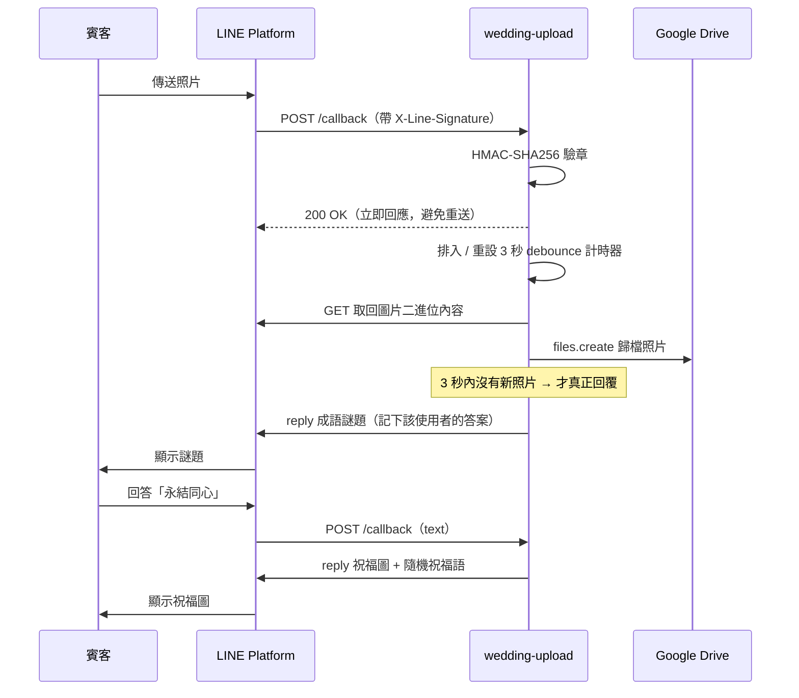

# wedding-upload

> 婚禮照片收集機器人：賓客把照片傳給 LINE 官方帳號，照片自動歸檔到 Google Drive，
> 機器人回一道成語謎題，答對就送出一張限定版祝福圖。

**2026/09/12 於真實婚禮現場上線運作**，服務當天到場的賓客。

`Java 17` · `Spring Boot 3.5` · `LINE Messaging API` · `Google Drive API v3` · `Docker`

---

## 為什麼做這個

婚禮當天賓客拍了很多照片，但全都散在各自手機裡，事後很難收齊；
傳到 LINE 群組又會被洗掉、難以整理。

所以做了一個 LINE 官方帳號：**賓客只要像平常聊天一樣把照片傳過來，照片就會自動進到我們的 Google Drive 資料夾。**
為了讓賓客有動力傳照片，收到照片後會回一道 emoji 成語謎題，答對就解鎖一張我們的 Q 版珍藏照。

## 實際體驗流程

```
賓客：[傳了 5 張照片]

        ⋯⋯ 3 秒後，5 張照片只回一次 ⋯⋯

機器人：照片已收到，謝謝你的分享！

        這裡有個小謎題
        ♾️ + 🎀 + 👫 + ❤️
        (猜一個成語)

        如果回答成功的話
        會有小驚喜唷！

賓客：永結同心

機器人：[Q 版珍藏照]
        答對啦！謝謝你參與我們的小遊戲，期待在婚禮上見到你喔！
```

猜錯不會有任何回應，賓客可以一直猜到對為止。

## 系統流程



## 設計決策

這些是實作過程中真正花時間的地方，也是這個專案比「串個 API 就好」複雜的原因。

### 1. Webhook 先回 200，重活丟到背景

LINE 的 webhook 如果沒有即時得到 2xx 就會重送，重送會造成同一張照片被上傳多次。
所以 [`LineWebhookController`](src/main/java/com/wedding/upload/web/LineWebhookController.java)
驗完章就立刻回 200，連 payload 解析失敗都照樣回 200；
下載圖片與上傳 Drive 的實際工作交給 `@Async` 在背景執行緒跑。

### 2. 用 3 秒 debounce 把連拍合併成一次回覆

賓客的習慣是「一次選 10 張一起傳」，而 LINE 會把它拆成 10 個獨立的 webhook event。
若每個 event 都回一次，賓客會被 10 道謎題洗版。

[`PhotoUploadService#scheduleBatchedReply`](src/main/java/com/wedding/upload/service/PhotoUploadService.java)
以 userId 為 key 維護一個 debounce 計時器：每張新照片都會取消上一個計時器並重新倒數，
**安靜 3 秒後才送出唯一一次回覆**。兩個細節：

- 計時器在**開始下載照片前**就先排好，不等 Drive 上傳完成。上傳/下載那幾秒的網路耗時留在背景跑完就好，
  賓客的體感延遲因此固定是 3 秒，不會隨照片張數與網路狀況飄動。
- 每次重設計時器時，同時把 `replyToken` 換成最新收到的那一個，
  所以即使賓客連續傳了一分鐘，用掉的也不會是已經過期的 token。

### 3. 常數時間的簽章比對

[`LineSignatureVerifier`](src/main/java/com/wedding/upload/line/LineSignatureVerifier.java)
用 channel secret 對 raw request body 做 HMAC-SHA256，並以 `MessageDigest.isEqual` 比對，
而不是 `String.equals`，避免因提早返回而洩漏資訊的 timing attack。
為了拿到**未經反序列化的原始 bytes**，controller 的參數刻意宣告成 `@RequestBody byte[]`——
用物件接再重新序列化會改變位元組內容，簽章就對不起來了。

### 4. LINE 預覽圖的 1 MB 限制

LINE 圖片訊息的兩個欄位大小上限不同：`originalContentUrl` 可到 10 MB，
但 `previewImageUrl` **只有 1 MB**。兩邊塞同一張大圖時，聊天室裡會是一片空白——
這是上線前才踩到的坑。

解法是 [`PuzzleImageCatalog`](src/main/java/com/wedding/upload/puzzle/PuzzleImageCatalog.java)
在啟動時掃描 `static/puzzles/` 建立索引，並自動配對 `static/puzzles/preview/` 底下的同檔名縮圖；
缺縮圖時退回用原圖、同時印出 WARN 指名是哪幾張，不會默默壞掉。
圖片規格與擺放方式見 [`static/puzzles/README.md`](src/main/resources/static/puzzles/README.md)。

> 當天真正送出的那批 Q 版照片是私人照片，不隨這個 repo 發佈。
> `static/puzzles/` 底下只放三張 `sample-*.jpg` 佔位圖，讓專案能直接跑起來；
> 自行部署時換成你自己的圖即可。

### 5. 用 feature flag 切換婚禮前後的行為

正式帳號在婚禮前幾個月就得開放給賓客加好友（電子喜帖、婚禮資訊選單），
但那時候還不該出謎題。`PhotoUploadService` 的 `PUZZLE_ENABLED` 旗標關閉時，
收到照片一律回「敬請期待」公告、且不指派謎題；婚禮當天只要翻成 `true` 就全線啟用。

### 6. 幾個刻意的小設計

- **猜錯保持沉默**：一個 reply token 只能用一次，回「答錯了」等於浪費掉賓客重試的機會，所以錯誤答案完全不回應。
- **只有恰好 4 個字的訊息才當成猜謎**：用 `codePointCount` 計算而非 `length()`，避免 emoji 與中文被算錯長度。
- **排除選單關鍵字**：LINE OA 圖文選單的「電子喜帖」、「婚禮資訊」剛好也是 4 個字，列入保留字不當答案處理。
- **比對前正規化**：先清掉全形／半形空白與換行，「永 結 同 心」一樣算對。

## 技術棧

| 項目 | 選擇 | 說明 |
|---|---|---|
| 語言 / 框架 | Java 17、Spring Boot 3.5.3 | `spring-boot-starter-web` |
| HTTP client | Spring `RestClient` | 分成 `api.line.me`（訊息）與 `api-data.line.me`（二進位內容）兩個 client |
| 雲端儲存 | Google Drive API v3 | OAuth refresh token 自動續期，檔案歸屬於真實使用者帳號 |
| 設定管理 | `@ConfigurationProperties` + record | 全部經由環境變數注入，不讓任何 secret 進 git |
| 狀態 | In-memory `ConcurrentHashMap` | 無資料庫（取捨見下方「已知限制」） |
| 部署 | 多階段 Docker build | JDK 建置 → JRE 執行、非 root、JVM 記憶體調校 |

## 專案結構

```
src/main/java/com/wedding/upload/
├─ WeddingUploadApplication.java      # @EnableAsync + @ConfigurationPropertiesScan
├─ web/LineWebhookController.java     # POST /callback：驗章 → 立即 200 → 分派事件
├─ service/PhotoUploadService.java    # 核心流程：debounce、謎題指派與批改、feature flag
├─ line/
│  ├─ LineApiClient.java              # 取圖片內容、reply 文字／圖片＋文字
│  ├─ LineSignatureVerifier.java      # HMAC-SHA256 常數時間驗章
│  └─ LineContent.java
├─ drive/GoogleDriveService.java      # files.create 上傳（支援共用雲端硬碟）
├─ puzzle/PuzzleImageCatalog.java     # 啟動掃描祝福圖 + 縮圖配對，隨機抽圖
└─ config/                            # AppProperties / LineProperties / DriveProperties / Drive bean

src/main/resources/static/puzzles/    # 祝福圖（原圖）─ repo 內只有佔位圖
└─ preview/                           # 同檔名縮圖，供 previewImageUrl 使用
```

## 設定

所有設定都走環境變數，`application.yml` 只負責對應，不含任何實際金鑰。

| 環境變數 | 必填 | 說明 |
|---|---|---|
| `LINE_CHANNEL_SECRET` | ✅ | LINE Developers → Basic settings → Channel secret，用於驗章 |
| `LINE_CHANNEL_TOKEN` | ✅ | Messaging API → Channel access token（long-lived） |
| `APP_PUBLIC_BASE_URL` | ✅ | 對外公開的 HTTPS 網址（LINE 要能抓到祝福圖），例如 `https://abc123.ngrok.io` |
| `GOOGLE_CLIENT_ID` | ✅ | Google Cloud → Credentials → OAuth client ID |
| `GOOGLE_CLIENT_SECRET` | ✅ | 同上 |
| `GOOGLE_REFRESH_TOKEN` | ✅ | 透過 OAuth consent flow 取得一次即可長期使用（如 OAuth Playground） |
| `GOOGLE_DRIVE_FOLDER_ID` |  | 目標資料夾 ID（網址 `/folders/` 後面那段）；留空則上傳到 My Drive 根目錄 |
| `PORT` |  | 服務埠號，預設 `8080` |

## 本機執行

需要 JDK 17 以上，以及一個能把外網導進 localhost 的工具（ngrok、Cloudflare Tunnel 等）——
LINE 的 webhook 與圖片網址都必須是公開的 HTTPS。

```bash
export LINE_CHANNEL_SECRET=... LINE_CHANNEL_TOKEN=...
export GOOGLE_CLIENT_ID=... GOOGLE_CLIENT_SECRET=... GOOGLE_REFRESH_TOKEN=...
export GOOGLE_DRIVE_FOLDER_ID=...
export APP_PUBLIC_BASE_URL=https://<your-tunnel>.ngrok.io

./mvnw spring-boot:run
```

再到 LINE Developers console 把 Webhook URL 設成 `https://<your-tunnel>.ngrok.io/callback` 並啟用，
就可以用自己的 LINE 傳照片測試了。

## 測試

```bash
./mvnw test
```

34 個單元測試，完全不碰網路，整包約 4 秒跑完。

| 測試類別 | 鎖住的行為 |
|---|---|
| `LineSignatureVerifierTest` | 正確簽章通過；換 secret、簽章後改動 body、缺少標頭、亂填字串都必須被拒；channel secret 沒設定時一律拒絕 |
| `LineWebhookControllerTest` | 驗章失敗回 401 且完全不碰業務邏輯；image / text 事件正確分派；批次送達的事件逐一處理；貼圖與非訊息事件忽略；payload 壞掉仍回 200（否則 LINE 會重送） |
| `PuzzleImageCatalogTest` | 跑在真正打包進 classpath 的那批祝福圖上：每張原圖都要配對到同檔名縮圖（1 MB 預覽限制的回歸測試）、隨機抽圖、`public-base-url` 未設定時回 empty |
| `PhotoUploadServiceTest` | 連拍合併成單次回覆且只用最新的 reply token、每張照片仍各自歸檔、歸檔檔名格式、Drive 上傳失敗不影響出題、答對送圖、答錯沉默、選單保留字與非 4 字訊息忽略、同一題只能領一次獎、沒有祝福圖時退回純文字 |

測試透過 `PhotoUploadService` 的 package-private 建構子把 debounce 縮短成 300 ms，
所以整套跑起來不用真的等 3 秒；正式環境的預設值仍是 3 秒。

## Docker

```bash
docker build -t wedding-upload .
docker run -p 8080:8080 --env-file .env wedding-upload
```

[`Dockerfile`](Dockerfile) 的幾個重點：先只複製 `pom.xml` 跑 `dependency:go-offline`，
讓依賴層能被 cache；執行階段換成 JRE 基底映像並以非 root 使用者執行；
JVM 參數設定 `-XX:MaxRAMPercentage=75 -XX:+UseSerialGC -XX:TieredStopAtLevel=1`，
針對只有幾百 MB 記憶體的小型雲端方案降低記憶體佔用與啟動時間。

## 已知限制

誠實記錄目前的取捨，這些在當時的規模（單場婚禮、數十位賓客、單一實例）下是刻意的選擇：

- **狀態存在記憶體**：「某位賓客目前該答哪一題」放在 `ConcurrentHashMap`，
  因此只能單一實例運作，重啟會遺失進行中的題目。要水平擴充需改用 Redis 之類的外部儲存。
- **只有單元測試**：外部服務全部以 mock 隔離，沒有真的打 LINE / Drive API 的整合測試，
  也沒有 Spring context 的啟動測試（那需要一組真的憑證）。
- **上傳失敗不重試**：Drive 上傳失敗只記錄 error log，不重試也不通知賓客。
- **謎題與圖片打包在 classpath**：新增謎題或祝福圖需要重新部署。
- **repo 內只有佔位圖**：真實的祝福圖是私人照片，不隨 repo 發佈，部署時需自行放入。
- **沒有防濫用機制**：沒有 rate limit，也不檢查檔案大小上限，僅因為使用者範圍封閉（婚禮賓客）而可接受。
